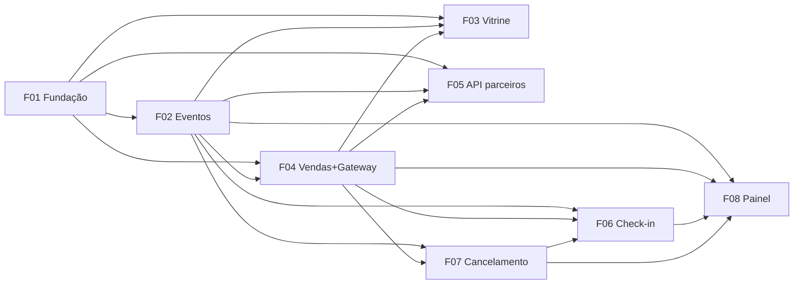

# PRD — Catraca MVP

> Product Requirements Document. Fonte: [brief.md](brief.md) (brief da fundadora, regras R01–R13).
> Documentos irmãos: [adr.md](adr.md) (decisões de arquitetura), [tdr.md](tdr.md) (desenho técnico), [specs.md](specs.md) (spec, plano e contrato por feature).

| Campo | Valor |
|---|---|
| Versão | 1.0 |
| Data | 2026-11-26 |
| Status | Aprovado para implementação |

---

## 1. Visão

A Catraca vende ingressos para eventos pequenos (shows em bar, workshops, meetups). O MVP permite que organizadores criem e operem eventos, que participantes comprem pela vitrine e que parceiros vendam pela API, **com as regras valendo quando as features se encontram**: evento cancelado não deixa ninguém entrar, estorno não conta como receita e a lotação nunca é ultrapassada, nem sob compras simultâneas.

### 1.1 Problema da primeira tentativa

| Falha observada | Causa provável | Como este PRD previne |
|---|---|---|
| Evento cancelado continuava deixando gente entrar | Check-in não consultava o estado do evento/ingresso definido por outra feature | Critério cross-feature CX-F07-F06 + ordem fixa de R10 |
| Painel somava estorno como receita | Painel calculava receita sem conhecer o status `refunded` | Critério cross-feature CX-F07-F08 |
| Show de 100 lugares vendeu 112 | Verificação de vaga e criação do ingresso fora de uma seção crítica | F04 com lock por evento (ADR-004) + teste de rajada nos gates |

### 1.2 Atores

| Ator | Autenticação | Capacidades |
|---|---|---|
| Visitante | nenhuma | ver a vitrine |
| Participante | conta própria (nome, e-mail, senha) | cadastrar-se, entrar, sair, comprar, ver "Meus ingressos" |
| Organizador | conta da seed | criar, editar, publicar, cancelar eventos próprios; check-in; painel |
| Parceiro | cabeçalho `X-Api-Key` | listar eventos, comprar, consultar ingresso |

### 1.3 Status do ingresso

| Rótulo (UI) | Valor (API) | Quando |
|---|---|---|
| pendente | `pending` | compra criada, aguardando gateway |
| confirmado | `confirmed` | gateway aprovou |
| recusado | `declined` | gateway recusou |
| cancelado | `cancelled` | estava pendente quando o evento foi cancelado |
| estornado | `refunded` | estava confirmado quando o evento foi cancelado |

`checkedIn` é um atributo à parte, não um status.

---

## 2. Features

| ID | Nome | Resumo | Regras |
|---|---|---|---|
| **F01** | Fundação e harness | Monorepo, Docker Compose, banco e migrações, autenticação por sessão, papéis, seed idempotente, comandos up/down/gates, AGENTS.md | R13 (base de papéis) |
| **F02** | Gestão de eventos | Área do organizador: listar, criar, editar, publicar eventos próprios; página de gestão com URL própria | R01, R02, R03, R04, R13 |
| **F04** | Motor de vendas e gateway | Serviço de compra com garantia de lotação, gateway simulado, worker assíncrono que aplica a resposta, cálculo de vagas | R05, R06, R07, R08, R09 (código) |
| **F03** | Vitrine e área do participante | Vitrine pública, cadastro/login do participante, compra pela vitrine, "Meus ingressos" | R02, R06, R07, R09 |
| **F05** | API de parceiros | As três rotas do contrato fixo, autenticação por chave, ordem dos erros | R02, R05, R06, R07 |
| **F07** | Cancelamento de evento | Cancelar evento publicado, transição em massa dos ingressos, bloqueio de edição/venda, imunidade a resposta tardia do gateway | R11 |
| **F06** | Check-in | Campo de check-in na página de gestão, ordem fixa de mensagens de R10, check-in atômico | R10 |
| **F08** | Painel do evento | Seis indicadores na página de gestão | R12 |

> A numeração segue a ordem em que as features foram identificadas; a ordem de execução é dada pelas waves (seção 4).

---

## 3. Provides / Consumes

### F01 — Fundação e harness
- **Provides**
  - `P-F01-1` Ambiente: `npm run up`, `npm run down`, `npm run gates`; Postgres e app em containers.
  - `P-F01-2` Esquema base e migrações (`users`, `sessions`, `events`, `tickets`, `payment_attempts`).
  - `P-F01-3` Autenticação por sessão (cookie), `requireRole('organizer' | 'participant')`, `currentUser`.
  - `P-F01-4` Seed idempotente: organizador A, organizador B, participante; chave de parceiro via env.
  - `P-F01-5` Layout HTML base, utilitários de dinheiro (centavos) e de data (ISO com offset `-03:00`), gerador de IDs (`evt_`, `tkt_`) e de códigos.
  - `P-F01-6` AGENTS.md, `project-state.json`, estrutura de `features/Fxx/`.
- **Consumes**: —

### F02 — Gestão de eventos
- **Provides**
  - `P-F02-1` Modelo de evento com estados `draft → published → cancelled` e repositório `EventsRepo`.
  - `P-F02-2` Consulta `listSellableEvents()` (publicado e não cancelado) — R02.
  - `P-F02-3` Página de gestão `GET /organizer/events/:id` com áreas (slots) para check-in (F06), cancelamento (F07) e painel (F08).
  - `P-F02-4` Guarda de posse `loadOwnedEvent(user, id)` → 404 se não for do organizador — R13.
  - `P-F02-5` Edição de lotação/preço respeitando R03 (lotação ≥ `pending`+`confirmed`, contados na tabela `tickets` de F01).
- **Consumes**: `P-F01-2`, `P-F01-3`, `P-F01-5`.

### F04 — Motor de vendas e gateway
- **Provides**
  - `P-F04-1` `purchaseTicket({ eventId, channel, buyerUserId?, buyerEmail, cardNumber })` → `{ ticket }` ou erro `invalid_request | event_not_available | sold_out`; resposta sem esperar o gateway — R06, R07.
  - `P-F04-2` `getSeatStats(eventId)` → `{ occupied, available }` — R05.
  - `P-F04-3` `PaymentGateway` (interface) + `SimulatedGateway` (tabela de finais) + worker de resultados — R08.
  - `P-F04-4` Transição condicional `applyGatewayResult(ticketId, outcome)` que só altera ingressos `pending`.
  - `P-F04-5` Código único de 8 caracteres por ingresso — R09.
  - `P-F04-6` `getTicket(ticketId)`, `listTicketsByUser(userId)`, `findTicketByCode(code)`.
- **Consumes**: `P-F01-2`, `P-F01-5`, `P-F02-1`, `P-F02-2`.

### F03 — Vitrine e área do participante
- **Provides**
  - `P-F03-1` `GET /` vitrine com eventos à venda.
  - `P-F03-2` Cadastro, login e logout do participante.
  - `P-F03-3` Compra pela vitrine (formulário de cartão) e mensagem **Ingressos esgotados**.
  - `P-F03-4` `GET /me/tickets` "Meus ingressos" (evento, status, código).
- **Consumes**: `P-F01-3`, `P-F02-2`, `P-F04-1`, `P-F04-2`, `P-F04-6`.

### F05 — API de parceiros
- **Provides**
  - `P-F05-1` `GET /api/partner/events`, `POST /api/partner/events/:id/purchases`, `GET /api/partner/tickets/:id` no contrato fixo.
  - `P-F05-2` Middleware `X-Api-Key` → 401 `{"error":"unauthorized"}`.
- **Consumes**: `P-F01-4` (chave), `P-F02-2`, `P-F04-1`, `P-F04-2`, `P-F04-6`.

### F07 — Cancelamento de evento
- **Provides**
  - `P-F07-1` `cancelEvent(eventId, organizerId)`: evento → `cancelled`; `confirmed → refunded`, `pending → cancelled` na mesma transação — R11.
  - `P-F07-2` Bloqueio de edição, republicação e venda de evento cancelado.
  - `P-F07-3` Botão "Cancelar evento" na página de gestão.
- **Consumes**: `P-F02-1`, `P-F02-3`, `P-F02-4`, `P-F04-4`.

### F06 — Check-in
- **Provides**
  - `P-F06-1` `POST /organizer/events/:id/checkin` com a ordem de mensagens de R10 e marcação atômica de `checked_in_at`.
  - `P-F06-2` Campo `checkedIn` disponível para leitura (API, painel).
- **Consumes**: `P-F02-3`, `P-F02-4`, `P-F04-6`, `P-F07-1` (estado `cancelled`).

### F08 — Painel do evento
- **Provides**
  - `P-F08-1` `getDashboard(eventId)` → Confirmados, Pendentes, Check-ins, Vagas disponíveis, Receita, Estornados — R12.
  - `P-F08-2` Bloco do painel na página de gestão.
- **Consumes**: `P-F02-3`, `P-F02-4`, `P-F04-2`, `P-F04-6`, `P-F06-2`, `P-F07-1`.

---

## 4. Grafo de dependências e waves

### 4.1 Lista de arestas (cada uma tem critério cross-feature na seção 5.2)

| Aresta | O que trafega |
|---|---|
| F01→F02 | autenticação, papel organizador, esquema |
| F01→F04 | esquema, gerador de IDs/códigos |
| F01→F03 | autenticação, papel participante |
| F01→F05 | chave de parceiro configurada pela seed/env |
| F02→F04 | estado do evento (só publicado vende), preço vigente, lotação |
| F02→F03 | `listSellableEvents()` |
| F02→F05 | `listSellableEvents()` |
| F02→F07 | evento publicado e página de gestão |
| F02→F06 | página de gestão e guarda de posse |
| F02→F08 | página de gestão e guarda de posse |
| F04→F03 | `purchaseTicket`, `listTicketsByUser`, vagas |
| F04→F05 | `purchaseTicket`, `getTicket`, vagas |
| F04→F07 | transição condicional de status |
| F04→F06 | `findTicketByCode` e status |
| F04→F08 | ingressos e preço pago |
| F07→F06 | estado `cancelled` do evento |
| F07→F08 | status `refunded` / `cancelled` |
| F06→F08 | `checked_in_at` |

> F02 valida a redução de lotação (R03) contando ingressos `pending`+`confirmed` na tabela `tickets`, que existe desde F01. Por isso não há aresta F04→F02 (evita ciclo); a integração com ingressos reais criados por F04 é comprovada pelo critério CX-F02-F04b, na aresta F02→F04.

### 4.2 Waves

| Wave | Features | Execução | Pré-condição |
|---|---|---|---|
| W0 | F01 | sequencial | — |
| W1 | F02 | sequencial | W0 avaliada e mergeada |
| W2 | F04 | sequencial | W1 avaliada e mergeada |
| **W3** | **F03, F05, F07** | **paralela** (3 worktrees, 3 PRs) | W2 avaliada e mergeada |
| **W4** | **F06, F08** | **paralela** (2 worktrees, 2 PRs) | W3 avaliada e mergeada |

Regra de ouro do handoff: uma wave só começa quando todas as features da wave anterior estão `done` em `project-state.json`, com relatório de avaliação aprovado e PR mergeado na `main`.

---

## 5. Critérios de aceite

Convenção: `AC-Fxx-n` é critério da própria feature; `CX-Fa-Fb` é critério cross-feature da aresta Fa→Fb. Cada critério cita as regras que verifica.

### 5.1 Critérios por feature

#### F01 — Fundação e harness
- **AC-F01-1** Em um clone limpo, `npm run up` sobe Postgres e app, aplica migrações e roda a seed; `GET $WEB/healthz` responde 200 sem nenhum outro passo.
- **AC-F01-2** `npm run down` seguido de `npm run up` funciona sem erro, inclusive a seed (idempotente).
- **AC-F01-3** Após `npm run down`, nenhuma porta do produto (3000; o Postgres não publica porta) responde e `docker ps --filter label=com.docker.compose.project=catraca` está vazio.
- **AC-F01-4** `npm run gates` executa lint, typecheck e testes automatizados e retorna código 0 na `main`.
- **AC-F01-5** A seed cria organizador A, organizador B e participante com as credenciais do README; rodar a seed duas vezes não duplica usuários nem falha.
- **AC-F01-6** Nenhuma variável de gateway real é necessária; `GATEWAY_MODE` padrão é `simulated`.
- **AC-F01-7** AGENTS.md na raiz contém comandos up/down/gates, regras do projeto e mapa de artefatos; CLAUDE.md contém apenas o apontamento para AGENTS.md.
- **AC-F01-8** Rotas da área de organizador rejeitam visitante (redireciona para login) e participante (403) (R13).

#### F02 — Gestão de eventos
- **AC-F02-1** Criar evento com nome, início, local, lotação (inteiro ≥ 1) e preço (> 0) gera evento em `draft` (R01, R02).
- **AC-F02-2** Criar ou editar com data de início no passado é rejeitado com mensagem de erro; lotação 0, lotação não inteira ou preço ≤ 0 são rejeitados (R01).
- **AC-F02-3** Publicar muda o estado para `published`; `listSellableEvents()` inclui publicados e exclui rascunhos (R02).
- **AC-F02-4** Reduzir a lotação abaixo das vagas ocupadas é rejeitado; aumentar é aceito (R03, R05).
- **AC-F02-5** Alterar o preço não altera `price_paid_cents` de ingressos já existentes (R03).
- **AC-F02-6** Cada evento tem página de gestão em `/organizer/events/:id`, onde se edita e publica (R04).
- **AC-F02-7** A lista `/organizer/events` mostra só eventos do organizador logado; abrir `/organizer/events/:id` de outro organizador responde 404 sem nome, números ou ingressos do evento (R13).

#### F04 — Motor de vendas e gateway
- **AC-F04-1** `purchaseTicket` cria ingresso `pending`, com código único de 8 caracteres, e retorna em menos de 500 ms sem esperar o gateway (R06, R09).
- **AC-F04-2** Ingresso `pending` conta como vaga ocupada; `available = capacity − (pending + confirmed)`; evento cancelado tem `available = 0` (R05).
- **AC-F04-3** Sem vaga, retorna `sold_out` e não cria ingresso (R07).
- **AC-F04-4** Em 30 chamadas concorrentes contra evento de lotação 5, exatamente 5 sucessos e 25 `sold_out`; repetido em 20 eventos novos no teste automatizado (R07).
- **AC-F04-5** Cartão final 0001 → `confirmed` em 2–5 s; 0002 → `declined` em 2–5 s; 0003 → `confirmed` em 30–40 s; 0004 → `declined` em 30–40 s; outro final → `declined` em 2–5 s (R08).
- **AC-F04-6** `declined` libera a vaga (R08, R05).
- **AC-F04-7** Cartão sem exatamente 16 dígitos ou e-mail inválido → `invalid_request` sem criar ingresso.
- **AC-F04-8** Evento inexistente, em rascunho ou cancelado → `event_not_available` (R02).
- **AC-F04-9** O ingresso grava `price_paid_cents` igual ao preço vigente no momento da compra (R03, R12).
- **AC-F04-10** `applyGatewayResult` sobre ingresso que não está `pending` não altera nada (base de R11).

#### F03 — Vitrine e área do participante
- **AC-F03-1** Visitante vê em `/` apenas eventos publicados e não cancelados (R02).
- **AC-F03-2** Participante se cadastra (nome, e-mail, senha), entra e sai; e-mail duplicado é rejeitado.
- **AC-F03-3** Participante logado compra pela vitrine; visitante é levado ao login.
- **AC-F03-4** Sem vaga, a página do evento mostra **Ingressos esgotados** no lugar do formulário, e uma tentativa que perde a corrida também mostra **Ingressos esgotados** (R07).
- **AC-F03-5** "Meus ingressos" lista evento, status (rótulo em português) e código de cada ingresso do participante, e só dele (R09).

#### F05 — API de parceiros
- **AC-F05-1** As três rotas sem `X-Api-Key` ou com chave inválida respondem 401 `{"error":"unauthorized"}`.
- **AC-F05-2** `GET /api/partner/events` retorna `[{id, name, startsAt, priceCents, availableSeats}]` só de eventos à venda (R02, R05).
- **AC-F05-3** `POST .../purchases` válido → 202 `{ticketId, code, status:"pending"}` (R06).
- **AC-F05-4** Ordem de erros: 422 `invalid_request` → 404 `event_not_available` → 409 `sold_out` (R07).
- **AC-F05-5** `GET /api/partner/tickets/:id` → 200 `{ticketId, code, eventId, status, checkedIn}` para ingressos de qualquer canal; inexistente → 404 `ticket_not_found`.
- **AC-F05-6** Rajada de 30 compras simultâneas em evento novo de lotação 5 → exatamente 5×202 e 25×409, em duas rodadas (R07).

#### F07 — Cancelamento de evento
- **AC-F07-1** Organizador cancela evento publicado pela página de gestão; o evento passa a `cancelled` de forma irreversível (R11).
- **AC-F07-2** Em até 10 s (na prática, na mesma transação), `confirmed → refunded` e `pending → cancelled` (R11).
- **AC-F07-3** Resposta do gateway que chega depois do cancelamento não muda o status de nenhum ingresso (R11).
- **AC-F07-4** Evento cancelado não pode ser editado nem republicado; a página de gestão não oferece edição e o POST de edição é rejeitado (R11).
- **AC-F07-5** Rascunho não pode ser cancelado (só "evento publicado" é cancelável) (R11).

#### F06 — Check-in
- **AC-F06-1** Código inexistente ou de outro evento → **Ingresso inválido para este evento** (R10).
- **AC-F06-2** Evento cancelado → **Evento cancelado** (R10).
- **AC-F06-3** Ingresso não `confirmed` → **Ingresso não confirmado** (R10).
- **AC-F06-4** Ingresso já com check-in → **Ingresso já utilizado** (R10).
- **AC-F06-5** Caso contrário → **Entrada liberada** e `checked_in_at` é gravado; dois check-ins concorrentes do mesmo código resultam em exatamente um **Entrada liberada** (R10).
- **AC-F06-6** A ordem das verificações é exatamente a de R10 (testada com casos que satisfazem duas condições ao mesmo tempo).

#### F08 — Painel do evento
- **AC-F08-1** Confirmados = ingressos `confirmed` (inclusive com check-in) (R12).
- **AC-F08-2** Pendentes = ingressos `pending` (R12).
- **AC-F08-3** Check-ins = `confirmed` com `checked_in_at` não nulo (R12).
- **AC-F08-4** Vagas disponíveis conforme R05 (R12, R05).
- **AC-F08-5** Receita = soma de `price_paid_cents` dos `confirmed`, formatada `R$ 350,00` (R12, R03).
- **AC-F08-6** Estornados = ingressos `refunded` (R12).

### 5.2 Critérios cross-feature (um ou mais por aresta)

| ID | Aresta | Critério | Regras | Coberto no contrato de |
|---|---|---|---|---|
| CX-F01-F02 | F01→F02 | Organizador A da seed entra e acessa `/organizer/events`; participante da seed recebe 403 e visitante é redirecionado ao login. | R13 | F02 |
| CX-F01-F04 | F01→F04 | Após `npm run down && npm run up`, ingressos e eventos persistidos continuam e o worker retoma pagamentos pendentes cujo `respond_at` já passou. | R08 | F04 |
| CX-F01-F03 | F01→F03 | Participante da seed entra pela tela de login de F03 e vê "Meus ingressos"; não acessa `/organizer/events` (403). | R13 | F03 |
| CX-F01-F05 | F01→F05 | A chave documentada no README (vinda de `.env`/seed) é aceita pelas três rotas; outra chave recebe 401. | — | F05 |
| CX-F02-F04 | F02→F04 | Compra em evento `draft` → `event_not_available`; após publicar, a compra é aceita e grava o preço vigente; após mudar o preço, a compra seguinte grava o novo preço e a anterior mantém o antigo. | R02, R03 | F04 |
| CX-F02-F04b | F02→F04 | Com 2 ingressos `pending` criados por `purchaseTicket` em evento de lotação 2, reduzir a lotação para 1 é rejeitado; após a recusa do gateway liberar uma vaga, reduzir para 1 é aceito. | R03, R05, R08 | F04 |
| CX-F02-F03 | F02→F03 | Evento criado por A não aparece na vitrine enquanto `draft` e aparece após publicar. | R02 | F03 |
| CX-F02-F05 | F02→F05 | Evento `draft` não aparece em `GET /api/partner/events`; publicado aparece com `availableSeats` = lotação e `priceCents` = preço×100. | R02, R05 | F05 |
| CX-F04-F03 | F04→F03 | Compra na vitrine com cartão 0001 aparece em "Meus ingressos" como pendente e, em até 5 s, confirmado, com o código gerado por F04. | R06, R08, R09 | F03 |
| CX-F04-F03b | F04→F03 | Com evento esgotado por compra via API (F05/F04), a vitrine mostra **Ingressos esgotados**. | R07 | F03 |
| CX-F04-F05 | F04→F05 | Compra via API com 0004 deixa `availableSeats` 0 em evento de lotação 2 já com 1 confirmado; após ~35 s, `GET tickets/:id` mostra `declined` e `availableSeats` volta a 1. | R05, R06, R08 | F05 |
| CX-F02-F07 | F02→F07 | Evento cancelado some da vitrine e da listagem da API; `POST .../purchases` → 404 `event_not_available`. | R02, R11 | F07 |
| CX-F04-F07 | F04→F07 | Com T5 (0003, pendente) e T6 (0001, confirmado), cancelar → T6 `refunded`, T5 `cancelled` em até 10 s; após 45 s da compra de T5, continua `cancelled`. | R08, R11 | F07 |
| CX-F02-F06 | F02→F06 | Organizador B não consegue fazer check-in no evento de A (POST de check-in responde 404). | R13 | F06 |
| CX-F04-F06 | F04→F06 | Ingresso comprado via API e confirmado: check-in → **Entrada liberada**; ingresso pendente → **Ingresso não confirmado**; código de outro evento → **Ingresso inválido para este evento**. | R09, R10 | F06 |
| CX-F07-F06 | F07→F06 | Após cancelar o evento, o código de um ingresso antes confirmado (agora `refunded`) resulta em **Evento cancelado** (ou a mensagem substitui o campo). | R10, R11 | F06 |
| CX-F02-F08 | F02→F08 | Organizador B abrindo a página de gestão do evento de A não vê nenhum número do painel. | R13 | F08 |
| CX-F04-F08 | F04→F08 | Após preço R$100 (2 confirmados) → mudança para R$150 → 1 confirmado, o painel mostra Receita R$ 350,00; compras da vitrine e da API somam igual. | R03, R12 | F08 |
| CX-F06-F08 | F06→F08 | Após um **Entrada liberada**, o painel passa de Check-ins 0 para 1 e Confirmados não muda. | R10, R12 | F08 |
| CX-F07-F08 | F07→F08 | Evento cancelado com 1 confirmado e 1 pendente mostra Confirmados 0, Pendentes 0, Vagas 0, Receita R$ 0,00, Estornados 1. | R11, R12 | F08 |

### 5.3 Rastreabilidade das regras

| Regra | Critérios |
|---|---|
| R01 | AC-F02-1, AC-F02-2 |
| R02 | AC-F02-1, AC-F02-3, AC-F03-1, AC-F04-8, AC-F05-2, CX-F02-F03, CX-F02-F04, CX-F02-F05, CX-F02-F07 |
| R03 | AC-F02-4, AC-F02-5, AC-F04-9, CX-F02-F04, CX-F02-F04b, CX-F04-F08 |
| R04 | AC-F02-6 |
| R05 | AC-F02-4, AC-F04-2, AC-F04-6, AC-F05-2, AC-F08-4, CX-F02-F04b, CX-F04-F05 |
| R06 | AC-F04-1, AC-F05-3, CX-F04-F03, CX-F04-F05 |
| R07 | AC-F04-3, AC-F04-4, AC-F03-4, AC-F05-4, AC-F05-6, CX-F04-F03b |
| R08 | AC-F04-5, AC-F04-6, CX-F01-F04, CX-F04-F03, CX-F04-F05, CX-F04-F07 |
| R09 | AC-F04-1, AC-F03-5, CX-F04-F03, CX-F04-F06 |
| R10 | AC-F06-1 … AC-F06-6, CX-F04-F06, CX-F07-F06, CX-F06-F08 |
| R11 | AC-F07-1 … AC-F07-5, CX-F02-F07, CX-F04-F07, CX-F07-F06, CX-F07-F08 |
| R12 | AC-F04-9, AC-F08-1 … AC-F08-6, CX-F04-F08, CX-F06-F08, CX-F07-F08 |
| R13 | AC-F01-8, AC-F02-7, CX-F01-F02, CX-F01-F03, CX-F02-F06, CX-F02-F08 |

---

## 6. Requisitos não funcionais

| ID | Requisito |
|---|---|
| NFR-1 | Subida com um único comando a partir de clone limpo; a máquina-alvo tem só Linux/macOS, Docker, Git e Node.js LTS. |
| NFR-2 | Compra responde em < 500 ms (p95 local), independentemente do gateway. |
| NFR-3 | Lotação garantida sob concorrência: invariante `pending + confirmed ≤ capacity` por evento, verificada em teste automatizado repetido. |
| NFR-4 | Cancelamento reflete nos ingressos em ≤ 10 s (meta: imediato, mesma transação). |
| NFR-5 | Resultado do gateway sobrevive a reinício do app (pagamentos pendentes persistidos). |
| NFR-6 | Nenhum número de cartão completo é persistido; só os 4 últimos dígitos. |
| NFR-7 | Senhas com hash bcrypt; cookie de sessão `HttpOnly`, `SameSite=Lax`. |

---

## 7. Processo de entrega (resumo)

1. Para cada feature: spec → plano → contrato ([specs.md](specs.md), depois copiados para `features/Fxx/`).
2. Implementador (sessão de agente A) implementa na branch `feat/Fxx-<nome>` (worktree nas waves paralelas).
3. Avaliador (sessão nova, contexto vazio) roda o contrato e grava `features/Fxx/reports/<data>-<sha>.md` (imutável).
4. Reprovou → correção → nova avaliação com novo relatório.
5. Aprovou → PR mergeado → `project-state.json` atualizado.
6. Ao final, Fluxo do avaliador completo contra a `main`, a partir de clone limpo.

---

## 8. Fora de escopo

- Deploy e qualquer ambiente além do local.
- Gateway de pagamento real, e-mail e notificações.
- App mobile e qualidade visual (nenhum critério avalia design).
- Cadastro de organizador pelo produto (contas vêm da seed).
- Mais de um ingresso por compra, mapa de assentos, cancelamento ou transferência de ingresso pelo participante.
- Atualização em tempo real (recarregar a página basta).
- Fuso horário configurável: o produto usa `America/Sao_Paulo` (offset `-03:00`).
- Recuperação de senha, edição de perfil, exclusão de conta.
- Despublicar evento (voltar para rascunho).
- Reembolso financeiro real: "estornado" é apenas status.
- Paginação e busca na vitrine.

---

## 9. Riscos

| Risco | Mitigação |
|---|---|
| Overbooking sob concorrência | Lock de linha por evento (ADR-004) + constraint de verificação + teste de rajada repetido nos gates |
| Resposta tardia do gateway sobrescrever cancelamento | Update condicional `WHERE status='pending'` (ADR-006) |
| Features prontas isoladamente e quebradas juntas | Critérios CX-* em contratos; Fluxo do avaliador como teste E2E (`npm run e2e`) rodado na `main` |
| Avaliador enviesado pelo implementador | Sessão separada, prompt fixo de avaliador, relatório imutável (ADR-010) |
| Testes lentos por causa dos cartões de 30–40 s | `GATEWAY_DELAY_SCALE` só no ambiente de teste (ADR-005) |
