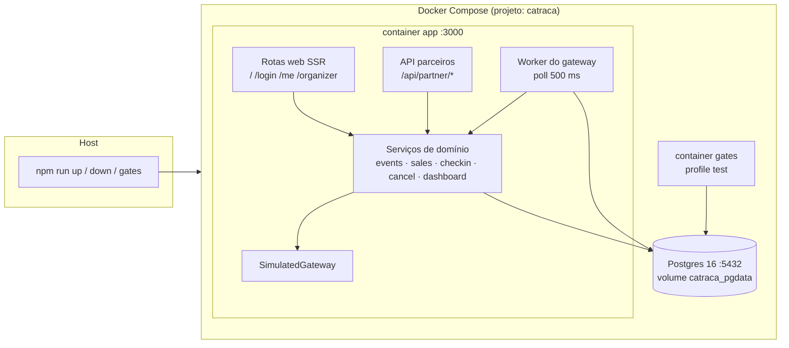
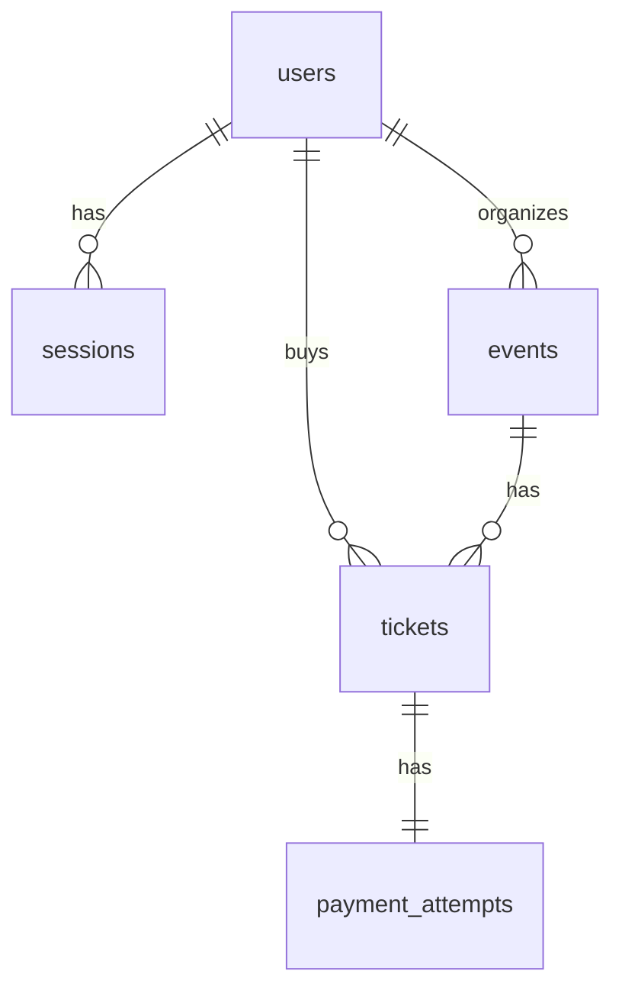

# TDR — Technical Design Record — Catraca MVP

> Desenho técnico que materializa o [PRD](prd.md) segundo as decisões do [ADR](adr.md). Detalhe por feature em [specs.md](specs.md).

| Campo | Valor |
|---|---|
| Versão | 1.0 |
| Data | 2026-11-26 |
| Endereços | `$WEB = $API = http://localhost:3000` |

---

## 1. Visão de componentes



## 2. Estrutura do repositório

```
/
├── AGENTS.md                  # porta de entrada dos agentes
├── CLAUDE.md                  # "Leia AGENTS.md"
├── README.md
├── project-state.json         # estado por feature
├── package.json               # scripts up/down/gates/seed/reset
├── compose.yml                # db + app
├── compose.test.yml           # db_test + gates
├── Dockerfile
├── .env.example               # PARTNER_API_KEY, GATEWAY_DELAY_SCALE...
├── docs/
│   ├── brief.md prd.md adr.md tdr.md specs.md seguranca.md
│   └── prompts/ implementer.md  evaluator.md
├── features/
│   └── F01-fundacao/ spec.md plan.md contract.md reports/
│   └── F02-eventos/ ... F08-painel/
├── migrations/                # 0001_init.sql ...
├── scripts/
│   ├── entrypoint.sh          # migrate → seed → node dist/server.js
│   ├── gates.mjs              # orquestra os gates (container + host)
│   ├── eval-helpers.sh        # helpers de shell para o avaliador
│   ├── check-reports.mjs      # relatórios com um único commit
│   ├── check-state.mjs        # project-state.json coerente
├── src/
│   ├── server.ts  app.ts  config.ts
│   ├── db/ pool.ts tx.ts
│   ├── lib/ ids.ts money.ts dates.ts html.ts
│   ├── modules/
│   │   ├── auth/        (F01)
│   │   ├── events/      (F02)
│   │   ├── sales/       (F04: purchase, seats, gateway, worker)
│   │   ├── storefront/  (F03)
│   │   ├── partner-api/ (F05)
│   │   ├── cancellation/(F07)
│   │   ├── checkin/     (F06)
│   │   └── dashboard/   (F08)
│   ├── seed/ seed.ts
│   └── views/ layout.ejs ...
└── test/ unit/ integration/ e2e/
```

Regra de import (lint): um módulo só importa módulos dos quais sua feature depende no grafo do PRD, mais `lib/`, `db/` e `auth/`.

## 3. Modelo de dados



```sql
-- migrations/0001_init.sql
CREATE TABLE users (
  id            TEXT PRIMARY KEY,               -- usr_xxxxxxxxxxxx
  name          TEXT NOT NULL,
  email         TEXT NOT NULL UNIQUE,           -- lower-case
  password_hash TEXT NOT NULL,
  role          TEXT NOT NULL CHECK (role IN ('participant','organizer')),
  created_at    TIMESTAMPTZ NOT NULL DEFAULT now()
);

CREATE TABLE sessions (
  id         TEXT PRIMARY KEY,                  -- 32 bytes aleatórios, base64url
  user_id    TEXT NOT NULL REFERENCES users(id) ON DELETE CASCADE,
  expires_at TIMESTAMPTZ NOT NULL
);

CREATE TABLE events (
  id            TEXT PRIMARY KEY,               -- evt_xxxxxxxxxxxx
  organizer_id  TEXT NOT NULL REFERENCES users(id),
  name          TEXT NOT NULL CHECK (length(name) BETWEEN 1 AND 200),
  starts_at     TIMESTAMPTZ NOT NULL,
  venue         TEXT NOT NULL CHECK (length(venue) BETWEEN 1 AND 200),
  capacity      INTEGER NOT NULL CHECK (capacity >= 1),
  price_cents   INTEGER NOT NULL CHECK (price_cents > 0),
  status        TEXT NOT NULL DEFAULT 'draft'
                CHECK (status IN ('draft','published','cancelled')),
  published_at  TIMESTAMPTZ,
  cancelled_at  TIMESTAMPTZ,
  created_at    TIMESTAMPTZ NOT NULL DEFAULT now(),
  updated_at    TIMESTAMPTZ NOT NULL DEFAULT now()
);
CREATE INDEX events_organizer_idx ON events(organizer_id);
CREATE INDEX events_sellable_idx  ON events(status, starts_at);

CREATE TABLE tickets (
  id               TEXT PRIMARY KEY,            -- tkt_xxxxxxxxxxxx
  event_id         TEXT NOT NULL REFERENCES events(id),
  code             TEXT NOT NULL UNIQUE,        -- 8 chars
  channel          TEXT NOT NULL CHECK (channel IN ('storefront','partner')),
  buyer_user_id    TEXT REFERENCES users(id),   -- NULL para parceiro
  buyer_email      TEXT NOT NULL,
  price_paid_cents INTEGER NOT NULL CHECK (price_paid_cents > 0),
  status           TEXT NOT NULL DEFAULT 'pending'
                   CHECK (status IN ('pending','confirmed','declined','cancelled','refunded')),
  checked_in_at    TIMESTAMPTZ,
  created_at       TIMESTAMPTZ NOT NULL DEFAULT now(),
  updated_at       TIMESTAMPTZ NOT NULL DEFAULT now(),
  CHECK (checked_in_at IS NULL OR status IN ('confirmed','refunded'))
);
CREATE INDEX tickets_event_status_idx ON tickets(event_id, status);
CREATE INDEX tickets_buyer_idx        ON tickets(buyer_user_id);

CREATE TABLE payment_attempts (
  ticket_id    TEXT PRIMARY KEY REFERENCES tickets(id),
  card_last4   TEXT NOT NULL,
  outcome      TEXT NOT NULL CHECK (outcome IN ('approved','declined')),
  respond_at   TIMESTAMPTZ NOT NULL,
  processed_at TIMESTAMPTZ,
  applied      BOOLEAN                         -- false = no-op (ticket já não estava pending)
);
CREATE INDEX payment_due_idx ON payment_attempts(respond_at) WHERE processed_at IS NULL;
```

Observações:
- Vagas ocupadas não são coluna: são `count(*) WHERE status IN ('pending','confirmed')` (ADR-004).
- `checked_in_at` permanece em ingresso que vira `refunded` (histórico), daí o `CHECK`.
- O número completo do cartão nunca é persistido (NFR-6).

## 4. Rotas

### 4.1 Web (SSR)

| Método | Rota | Papel | Feature | Descrição |
|---|---|---|---|---|
| GET | `/healthz` | — | F01 | 200 `{"ok":true}` quando DB acessível |
| GET | `/login` · POST `/login` | — | F01 | login (participante e organizador) |
| POST | `/logout` | logado | F01 | encerra sessão |
| GET | `/signup` · POST `/signup` | — | F03 | cadastro de participante |
| GET | `/` | — | F03 | vitrine |
| GET | `/events/:id` | — | F03 | detalhe + formulário de compra ou **Ingressos esgotados** |
| POST | `/events/:id/purchase` | participante | F03 | compra pela vitrine |
| GET | `/me/tickets` | participante | F03 | Meus ingressos |
| GET | `/organizer/events` | organizador | F02 | lista dos próprios eventos |
| GET/POST | `/organizer/events/new` | organizador | F02 | criar |
| GET | `/organizer/events/:id` | dono | F02 | **página de gestão** (R04) |
| POST | `/organizer/events/:id` | dono | F02 | editar |
| POST | `/organizer/events/:id/publish` | dono | F02 | publicar |
| POST | `/organizer/events/:id/cancel` | dono | F07 | cancelar |
| POST | `/organizer/events/:id/checkin` | dono | F06 | check-in |

A página de gestão é composta por blocos: `edição/publicação` (F02), `cancelamento` (F07), `check-in` (F06), `painel` (F08). Cada bloco é um partial EJS em `src/modules/<feature>/views/` incluído por F02 via registro de "slots" (`managementSlots.register(name, renderFn)`), o que reduz conflitos de merge na wave paralela.

### 4.2 API de parceiros (contrato fixo)

| Método | Rota | Sucesso | Erros (ordem) |
|---|---|---|---|
| GET | `/api/partner/events` | 200 `[{id,name,startsAt,priceCents,availableSeats}]` | 401 |
| POST | `/api/partner/events/:eventId/purchases` | 202 `{ticketId,code,status:"pending"}` | 401 → 422 `invalid_request` → 404 `event_not_available` → 409 `sold_out` |
| GET | `/api/partner/tickets/:ticketId` | 200 `{ticketId,code,eventId,status,checkedIn}` | 401 → 404 `ticket_not_found` |

- `startsAt`: ISO 8601 com offset de `America/Sao_Paulo` (ex.: `2026-12-05T21:00:00-03:00`).
- Validação do corpo: `buyerEmail` string com formato de e-mail; `cardNumber` string `^\d{16}$`. Campo ausente, tipo errado ou JSON malformado → 422.
- A checagem da chave roda em `onRequest` do prefixo `/api/partner`, antes de qualquer parsing; comparação em tempo constante (`crypto.timingSafeEqual`).

## 5. Fluxos críticos

### 5.1 Compra (F04, chamada por F03 e F05)

```mermaid
sequenceDiagram
  participant C as Canal (vitrine/API)
  participant S as SalesService
  participant DB as Postgres
  participant G as SimulatedGateway
  C->>S: purchaseTicket(eventId, email, card)
  S->>S: valida email + 16 dígitos (senão invalid_request)
  S->>DB: BEGIN; SELECT ... FROM events WHERE id FOR UPDATE
  alt evento ausente / draft / cancelled
    S-->>C: event_not_available
  end
  S->>DB: SELECT count(*) pending+confirmed
  alt count >= capacity
    S-->>C: sold_out (ROLLBACK)
  end
  S->>G: authorize(card) → outcome, delay
  S->>DB: INSERT ticket(pending, price_paid=price_cents) + payment_attempt(respond_at)
  S->>DB: COMMIT
  S-->>C: ticket {id, code, pending}
```

`authorize` do simulado é puro (sem I/O): decide pelo final do cartão e sorteia o atraso. Com um gateway real, a chamada sairia da transação e o resultado chegaria por webhook gravando em `payment_attempts` — a interface já comporta isso.

### 5.2 Aplicação do resultado (worker)

```
loop a cada 500 ms:
  BEGIN
  rows = SELECT ... FROM payment_attempts
         WHERE processed_at IS NULL AND respond_at <= now()
         ORDER BY respond_at LIMIT 50 FOR UPDATE SKIP LOCKED
  para cada row:
     SELECT 1 FROM events WHERE id = ticket.event_id FOR UPDATE   -- ordem total com compra/cancelamento
     novo = approved ? 'confirmed' : 'declined'
     n = UPDATE tickets SET status = novo, updated_at = now()
         WHERE id = row.ticket_id AND status = 'pending'
     UPDATE payment_attempts SET processed_at = now(), applied = (n = 1)
  COMMIT
```

Para evitar deadlock entre o lock de `payment_attempts` e o de `events`, o worker processa cada linha em transação própria (lock do evento primeiro, depois do attempt com `SKIP LOCKED`).

### 5.3 Cancelamento (F07)

```sql
BEGIN;
SELECT status FROM events WHERE id=$1 AND organizer_id=$2 FOR UPDATE;  -- 404 se não achar
-- status <> 'published' → erro "Só eventos publicados podem ser cancelados"
UPDATE events  SET status='cancelled', cancelled_at=now() WHERE id=$1;
UPDATE tickets SET status='refunded'  WHERE event_id=$1 AND status='confirmed';
UPDATE tickets SET status='cancelled' WHERE event_id=$1 AND status='pending';
COMMIT;
```

### 5.4 Check-in (F06)

```
code = upper(trim(input))
t = SELECT * FROM tickets WHERE code = $code AND event_id = $eventId
1. t inexistente                   → "Ingresso inválido para este evento"
2. event.status = 'cancelled'      → "Evento cancelado"
3. t.status <> 'confirmed'         → "Ingresso não confirmado"
4. t.checked_in_at IS NOT NULL     → "Ingresso já utilizado"
5. UPDATE tickets SET checked_in_at = now()
     WHERE id = t.id AND status='confirmed' AND checked_in_at IS NULL
   n = 1 → "Entrada liberada"; n = 0 → reavalia a partir do passo 2 (corrida)
```

A UI de check-in, em evento cancelado, mostra a mensagem **Evento cancelado** no lugar do campo; o endpoint continua respondendo pela lista acima (vale para quem enviar POST direto).

### 5.5 Edição de evento (F02)

```
BEGIN; SELECT * FROM events WHERE id AND organizer_id FOR UPDATE
- status = 'cancelled' → rejeita ("Evento cancelado não pode ser editado")
- starts_at <= now() → rejeita (R01)
- capacity < count(pending+confirmed) → rejeita (R03)
- UPDATE events SET ... ; COMMIT
```

### 5.6 Painel (F08)

```sql
SELECT
  count(*) FILTER (WHERE status='confirmed')                              AS confirmed,
  count(*) FILTER (WHERE status='pending')                                AS pending,
  count(*) FILTER (WHERE status='confirmed' AND checked_in_at IS NOT NULL) AS checkins,
  count(*) FILTER (WHERE status='refunded')                               AS refunded,
  coalesce(sum(price_paid_cents) FILTER (WHERE status='confirmed'),0)     AS revenue_cents,
  count(*) FILTER (WHERE status IN ('pending','confirmed'))               AS occupied
FROM tickets WHERE event_id = $1;
-- available = event.status='cancelled' ? 0 : capacity - occupied
```

Uma única consulta garante que os seis números são de um mesmo instante.

## 6. Gateway simulado

| Final | Resultado | Atraso padrão | Atraso sorteado (implementação) |
|---|---|---|---|
| 0001 | approved | 2–5 s | uniforme [2,0 ; 4,5] s |
| 0002 | declined | 2–5 s | uniforme [2,0 ; 4,5] s |
| 0003 | approved | 30–40 s | uniforme [30 ; 39,5] s |
| 0004 | declined | 30–40 s | uniforme [30 ; 39,5] s |
| outro | declined | 2–5 s | uniforme [2,0 ; 4,5] s |

O teto é reduzido em 0,5 s para absorver o intervalo do worker e manter o resultado observável dentro da faixa do brief. `GATEWAY_DELAY_SCALE` multiplica os atrasos (padrão 1; gates usam 0,01). Cartão sem 16 dígitos é rejeitado antes de criar ingresso.

## 7. Configuração

| Variável | Padrão | Uso |
|---|---|---|
| `CATRACA_PORT` | 3000 | porta do produto no host (compose) |
| `PORT` | 3000 | porta HTTP dentro do container |
| `DATABASE_URL` | `postgres://catraca:catraca@db:5432/catraca` | conexão |
| `PG_POOL_MAX` | 30 | suporta rajada de 30 |
| `PARTNER_API_KEY` | `catraca-partner-dev-key` | chave do parceiro (documentada no README) |
| `GATEWAY_MODE` | `simulated` | único modo |
| `GATEWAY_DELAY_SCALE` | 1 | aceleração apenas em teste |
| `WORKER_INTERVAL_MS` | 500 | polling do worker |
| `SESSION_TTL_HOURS` | 24 | expiração de sessão |
| `TZ_DISPLAY` | `America/Sao_Paulo` | exibição e `startsAt` |

Os padrões ficam no `compose.yml`, então `npm run up` funciona sem `.env`.

## 8. Seed

| Conta | E-mail | Senha | Papel |
|---|---|---|---|
| Organizador A | `org.a@catraca.dev` | `catraca123` | organizer |
| Organizador B | `org.b@catraca.dev` | `catraca123` | organizer |
| Participante | `participante@catraca.dev` | `catraca123` | participant |
| Parceiro | — | `X-Api-Key: catraca-partner-dev-key` | — |

Idempotência: `INSERT ... ON CONFLICT (email) DO NOTHING` com IDs fixos (`usr_seed_org_a`, ...). Nenhum evento é semeado (o fluxo do avaliador cria os seus).

## 9. Harness

### 9.1 compose.yml (resumo)

```yaml
name: catraca
services:
  db:
    image: postgres:16-alpine
    environment: { POSTGRES_USER: catraca, POSTGRES_PASSWORD: catraca, POSTGRES_DB: catraca }
    volumes: [catraca_pgdata:/var/lib/postgresql/data]
    healthcheck: { test: ["CMD","pg_isready","-U","catraca"], interval: 2s, retries: 30 }
  app:
    build: .
    depends_on: { db: { condition: service_healthy } }
    ports: ["${CATRACA_PORT:-3000}:3000"]
    environment: { ... padrões da seção 7 ... }
    healthcheck: { test: ["CMD","wget","-qO-","http://localhost:3000/healthz"], interval: 2s, retries: 60 }
volumes: { catraca_pgdata: {} }
```

`compose.test.yml` adiciona, sob `profiles: [test]`, `db_test` (sem porta publicada, tmpfs) e `gates` (mesma imagem, alvo de build `dev`, com `GATEWAY_DELAY_SCALE=0.01`) cujo comando é `npm run gates:inner`.

### 9.2 Gates (`gates:inner`)

1. `eslint .` (inclui regra de fronteira entre módulos)
2. `tsc --noEmit`
3. `vitest run` — unidade + integração (concorrência repetida 20×, máquina de estados, ordem de R10, painel)
   - inclui `test/e2e/` — app em processo contra `db_test`, passos 2–16 do Fluxo do avaliador com gateway acelerado (cresce a cada feature)
4. `node scripts/check-reports.mjs` (no host) — cada relatório com exatamente um commit
5. `node scripts/check-state.mjs` (no host) — `project-state.json` coerente (feature, status, caminho existe, relatório `APPROVED`)

Saída diferente de zero em qualquer etapa reprova os gates.

## 10. Estratégia de testes

| Nível | Ferramenta | Foco |
|---|---|---|
| Unidade | Vitest | dinheiro, datas, gerador de código, tabela do gateway, validação |
| Integração | Vitest + Postgres real | repositórios, `purchaseTicket` concorrente, transições condicionais, cancelamento × worker, check-in, painel |
| HTTP | `app.inject()` | contrato da API de parceiros (corpos e status exatos), guarda R13 |
| E2E | Vitest `test/e2e/` | Fluxo do avaliador completo (passos 2–16) |
| Manual/avaliador | curl + navegador | contrato de cada feature, com evidência no relatório |

Teste de concorrência: `Promise.all` de 30 chamadas com conexões distintas do pool; afirma 5/25 e o invariante; repete em 20 eventos novos. Teste de corrida cancelamento × gateway: cria pendente com `respond_at` imediato, inicia worker e cancelamento ao mesmo tempo, repete 50×, afirma estado final sempre `cancelled` ou (`confirmed→refunded`) — nunca `confirmed` em evento cancelado.

## 11. Observabilidade

Logs JSON (pino) com `reqId`, `eventId`, `ticketId`; eventos `purchase.created`, `purchase.sold_out`, `gateway.applied`, `gateway.noop`, `event.cancelled`, `checkin.result`. Suficiente para evidência em relatórios de avaliação.

## 12. Segurança

- Senhas bcrypt; sessão aleatória de 256 bits; cookie `HttpOnly`, `SameSite=Lax`.
- Verificação de `Origin` em POST de formulários.
- Guarda de posse retorna 404 indistinguível de inexistente.
- Escape automático do EJS (`<%= %>`) em todo conteúdo de usuário.
- SQL sempre parametrizado.
- Chave de parceiro comparada em tempo constante; nunca logada.

## 13. Fluxo de trabalho com agentes

| Etapa | Quem | Artefato |
|---|---|---|
| Spec/plano/contrato | agente planejador (revisado pelo humano) | `features/Fxx/{spec,plan,contract}.md` |
| Implementação | agente implementador, branch `feat/Fxx-*` (worktree em W3/W4) | código + testes |
| Avaliação | agente avaliador, sessão nova | `features/Fxx/reports/<data>-<sha>.md` |
| Integração | PR para `main`, gates verdes | PR no GitHub |
| Estado | quem mergeia | `project-state.json` |

Waves paralelas: `git worktree add ../catraca-F03 -b feat/F03-vitrine`, idem F05 e F07; uma sessão de agente por worktree (painéis tmux). Conflitos esperados: `src/app.ts` (registro de rotas) e página de gestão — mitigados pelo registro de módulos/slots, resolvidos no PR que mergear por último.

Formato de `project-state.json`:

```json
{
  "updatedAt": "2026-11-26T00:00:00-03:00",
  "features": [
    { "id": "F01", "name": "Fundação e harness", "wave": 0, "status": "done",
      "branch": "feat/F01-fundacao", "pr": "https://github.com/<user>/catraca/pull/1",
      "latestReport": "features/F01-fundacao/reports/2026-11-27-1030-abc1234.md" }
  ]
}
```

Status possíveis: `todo`, `in_progress`, `in_review`, `changes_requested`, `done`.
